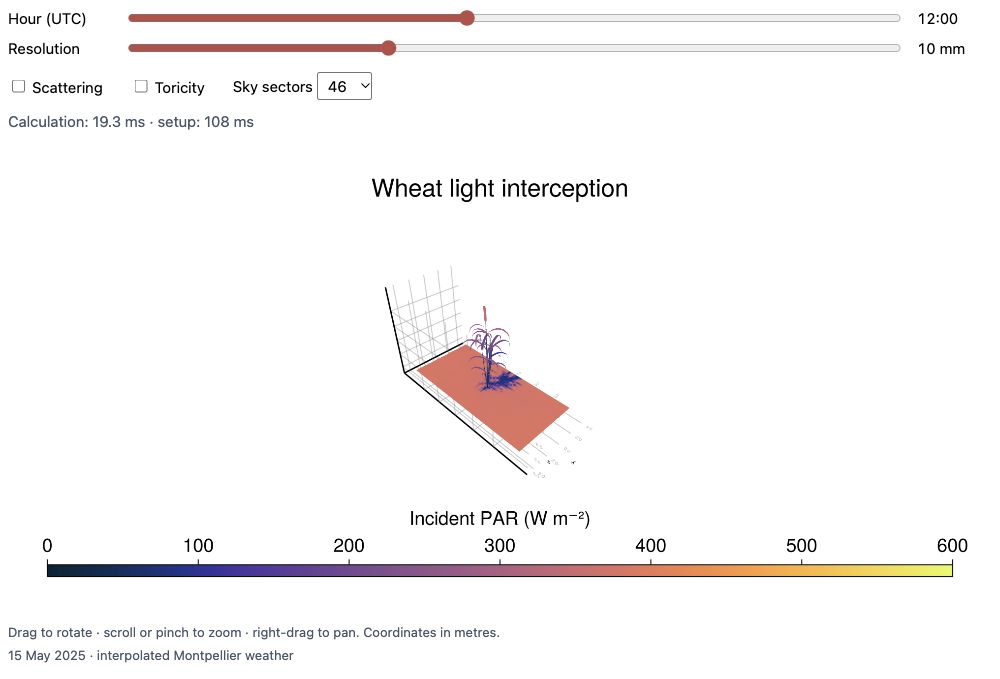

```@meta
CurrentModule = ArchimedLight
```

# Fast radiative transfer in 3D scenes

ArchimedLight.jl computes light interception and scattering in three-dimensional scenes, from individual organs or objects to crop canopies, using a fast radiation transfer model. Read an existing scene
or build one in Julia, simulate its light environment, and inspect incident and
absorbed radiation for each organ.

## Try it in your browser

Here's a live example of a wheat plant in a field generated using ArchiCrop (Braud et al. 2026), with incident PAR irradiance coloured on the plant and ground.

**This example is not precomputed; it runs the simulations live in your browser** like it would in a real-world scenario. Change the hour of simulation, explore the effect of light scattering, periodic boundaries (`toricity=true`), pixel resolution (lower is better), and number of sky sectors (higher is better).

```@raw html
<figure id="live-wheat" data-state="preview">
  <div class="live-wheat-stage" aria-busy="false">
    
  </div>
  <figcaption class="live-wheat-caption">
    <span class="live-wheat-status" role="status" aria-live="polite"></span>
    <a class="live-wheat-open" href="assets/live-wheat/index.html" target="_blank" rel="noopener">Open the standalone demo</a>.
    All light calculations run in your browser.
  </figcaption>
  <noscript><p>Enable JavaScript to interact with the scene.</p></noscript>
</figure>
```

```@raw html
<details>
  <summary>About the example and more scenes</summary>
  <p>Weather was downloaded using PlantMeteo for the Montpellier location on 15 May 2025.
  The browser runs ArchimedLight compiled to WASM.</p>
  <div class="archimed-animations">
    <video autoplay loop muted playsinline
           poster="assets/archimedlight_day_cycle_1.png"
           preload="metadata"
           style="max-width: 100%; height: auto;"
           aria-label="Wheat scene coloured by incident PAR irradiance.">
      <source src="assets/archimedlight_day_cycle_1.mp4" type="video/mp4">
      Your browser does not support embedded video.
    </video>
    <video autoplay loop muted playsinline
           poster="assets/archimedlight_day_cycle_2.png"
           preload="metadata"
           style="max-width: 100%; height: auto;"
           aria-label="Agrivoltaic wheat scene with shade from solar panels, coloured by incident PAR irradiance.">
      <source src="assets/archimedlight_day_cycle_2.mp4" type="video/mp4">
      Your browser does not support embedded video.
    </video>
  </div>
  <p>The day-cycle animations run the wheat and agrivoltaic wheat benchmark
  scenes every 30 minutes over a representative clear-sky day. About 2,500
  receiving ground tiles show the moving shade on the same incident-PAR scale.
  Reproduce them with
  <a href="https://github.com/VEZY/ArchimedLight.jl/blob/main/docs/make_video/make_video.jl">docs/make_video/make_video.jl</a>.</p>
</details>
```

## Quick Start

This tutorial simulated a coffee plant in a 3D scene.

```@example home_quick_start
using ArchimedLight

repo_root = normpath(joinpath(dirname(pathof(ArchimedLight)), ".."))
config = joinpath(repo_root, "example_2", "config.yml")
sim, meteo = read_simulation(config)
update_options!(sim, LightOptions(sim.options; pixel_size=0.01))

step = run_light(sim, first(meteo))

step.budget.incident_flux.total.par;
step.budget.absorbed_energy.total.par;
nothing # hide
```

The simulation results are returned as a `LightBudget`, grouped by quantity and waveband. You can then export the results and plot them easily. Look at the getting started page to see how.

## Learn More

- [Getting Started](getting_started.md): run your first simulation.
- [File-Based Workflow](tutorial_files.md) and [Interactive Workflow](tutorial_interactive.md): load a scene or build one in memory.
- [Model Pipeline](theory_pipeline.md) and [Evaluation](evaluation.md): understand the methods and their validation.
- [PlantSimEngine Coupling](plantsimengine.md): connect light to other plant processes.
- [Configuration](reference_config.md), [Outputs](outputs.md) and [API Reference](api.md): find exact options and result definitions.
