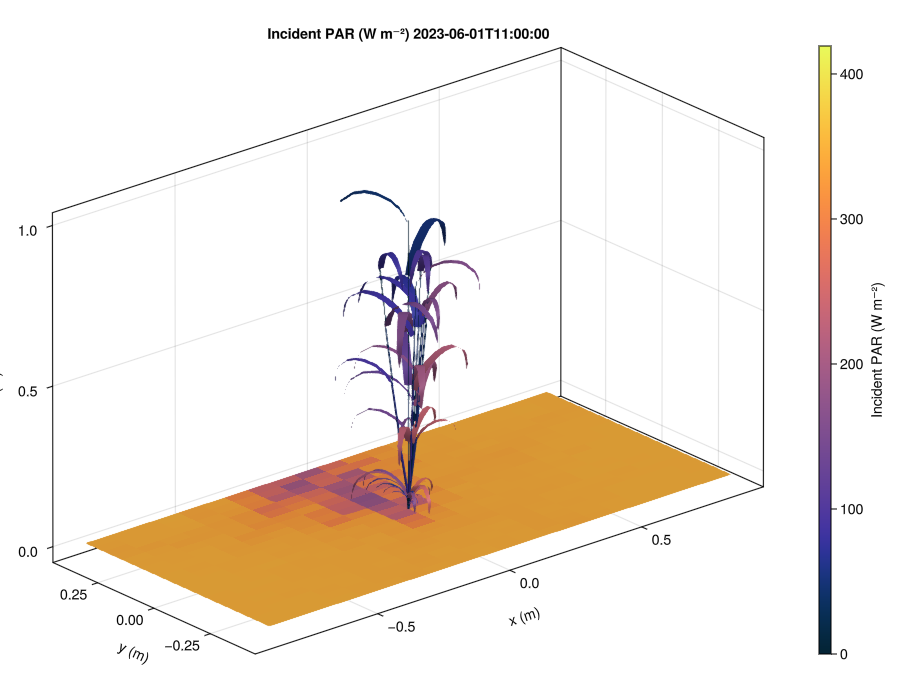
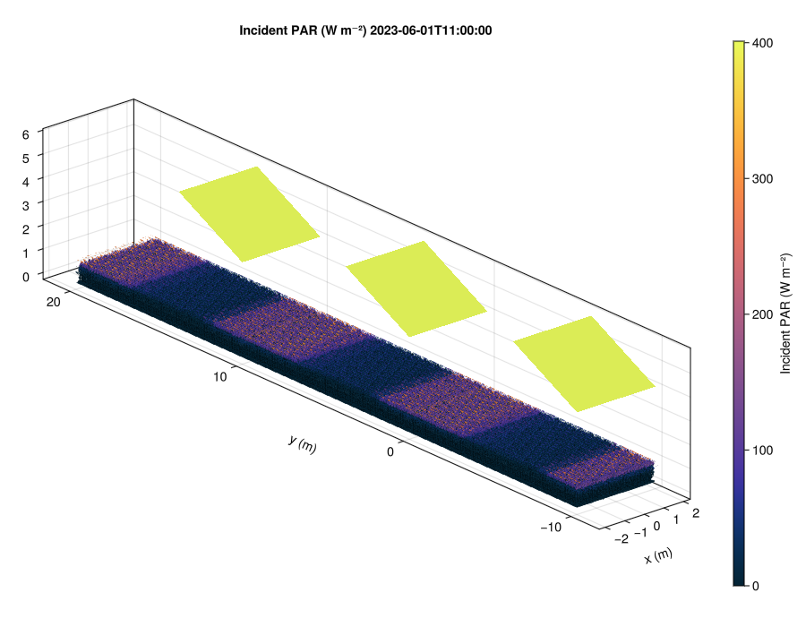

```@meta
CurrentModule = ArchimedLight
```

# Explore light in a plant scene

Move the sun over this wheat plant: change the **hour** to follow the shadow,
turn **scattering** or
**toricity** on and off, or compare the **pixel resolution** and **16, 46 or
136 sky sectors**. Plant organs and ground share the same incident PAR scale
(W m⁻²). Toricity repeats the plot periodically for the light calculation.

```@raw html
<figure id="live-wheat" data-state="preview">
  <div class="live-wheat-stage" aria-busy="false">
    
  </div>
  <figcaption class="live-wheat-caption">
    <span class="live-wheat-status" role="status" aria-live="polite"></span>
    <a class="live-wheat-open" href="assets/live-wheat/index.html" target="_blank" rel="noopener">Open the standalone demo</a>.
    The light calculation runs in your browser; no Julia server is needed.
  </figcaption>
  <noscript><p>Enable JavaScript to interact with the scene. The preview remains available above.</p></noscript>
</figure>
```

This teaching scene uses the benchmark wheat architecture, whose cultivar is
unspecified, and interpolated Montpellier weather for 15 May 2025. Architecture
stays fixed while the hour changes. The browser runs a compiled specialization
of the ArchimedLight calculations; see the [demo source and validation notes](https://github.com/VEZY/ArchimedLight.jl/tree/main/docs/live_wheat).

<details>
<summary>More scenes and reproducible day-cycle animations</summary>

```@raw html
<div class="archimed-animations">
  
  
</div>
```

These animations run the wheat and agrivoltaic wheat scenes from the
`archimedlight-benchmark-scenes` artifact every 30 minutes over a representative
clear-sky day. Each plot has about 2,500 explicit ground tiles, making the
moving projected shade visible while the same color scale tracks incident PAR
irradiance through the day. The script to reproduce these figures is in
[`docs/make_video/make_video.jl`](https://github.com/VEZY/ArchimedLight.jl/blob/main/docs/make_video/make_video.jl).
</details>

## Scope

ArchimedLight reimplements the light core of ARCHIMED using rasterization for
first-order interception and an iterative scattering calculation. Build or read
a scene, define optical properties, create a `LightSimulation`, then call
`run_light` for one meteo row or a complete meteo table.

- ARCHIMED-style scene/model/meteo ingestion: `.ops`, `.opf`, `.gwa`, YAML models, and meteo CSV files
- File-based and in-memory workflows through the same runtime API
- Directional sky discretization with the standard ARCHIMED turtle sector counts
- First-order interception by CPU rasterization / z-buffer style projection
- Iterative scattering using the same directional visibility information
- Attachment of `Ri_*` and `Ra_*` values back onto MTG nodes for inspection and export
- Fixture-based parity work against the historical Java implementation

Energy balance, transpiration, and photosynthesis are intentionally out of scope for this package. The historical ARCHIMED documents referenced throughout this site still matter for the model vocabulary and physical assumptions, but the Julia package documented here currently implements the light-only core.

## Quick Start

This tutorial uses 1 cm pixels instead of the default 1 mm pixels to keep the coffee simulation quick.

```@example home_quick_start
using ArchimedLight

repo_root = normpath(joinpath(dirname(pathof(ArchimedLight)), ".."))
config = joinpath(repo_root, "example_2", "config.yml")
sim, meteo = read_simulation(config)
update_options!(sim, LightOptions(sim.options; pixel_size=0.01))

step = run_light(sim, first(meteo))

step.budget.incident_flux.total.par;
step.budget.absorbed_energy.total.par;
```

The simulation results are grouped by quantity and waveband in `LightBudget`. When you attach those values back onto the scene, the default attribute names keep the standard ARCHIMED naming convention such as `Ri_PAR_f`, `Ri_PAR_q`, and `Ra_PAR_q`.

## Read This Site In Three Passes

- Start with [Getting Started](getting_started.md) if you want one runnable coffee example with the minimum number of moving parts.
- Continue with [Beginner Workflows](tutorial_beginner_workflows.md), [File-Based Workflow](tutorial_files.md), or [Interactive Workflow](tutorial_interactive.md) depending on whether your scene already exists on disk or is being built in Julia.
- Use the reference pages for exact file keys, scene semantics, model structure, meteo columns, and outputs.

## Documentation Map

- [Getting Started](getting_started.md)
- [Beginner Workflows](tutorial_beginner_workflows.md)
- [Tutorial: File-Based Workflow](tutorial_files.md)
- [Tutorial: Interactive Workflow](tutorial_interactive.md)
- [Configuration And Options Reference](reference_config.md)
- [Scene Files And Semantics](reference_scene.md)
- [Model Files Reference](reference_models.md)
- [Meteo Inputs Reference](reference_meteo.md)
- [Outputs](outputs.md)
- [Evaluation: scattering in 3D](evaluation.md)
- [CPU Performance Benchmarks](performance_benchmarks.md)
- [Pipeline Overview](theory_pipeline.md)
- [First-Order Interception](theory_interception.md)
- [Scattering And Optical Assumptions](theory_scattering.md)
- [Full Example](full_example.md)
- [Composable Stages](stages.md)
- [GPU Backends And Benchmarks](gpu_backends.md)
- [API Reference](api.md)

## Contributors

```@raw html
<!-- ALL-CONTRIBUTORS-LIST:START - Do not remove or modify this section -->
<!-- prettier-ignore-start -->
<!-- markdownlint-disable -->

<!-- markdownlint-restore -->
<!-- prettier-ignore-end -->

<!-- ALL-CONTRIBUTORS-LIST:END -->
```
