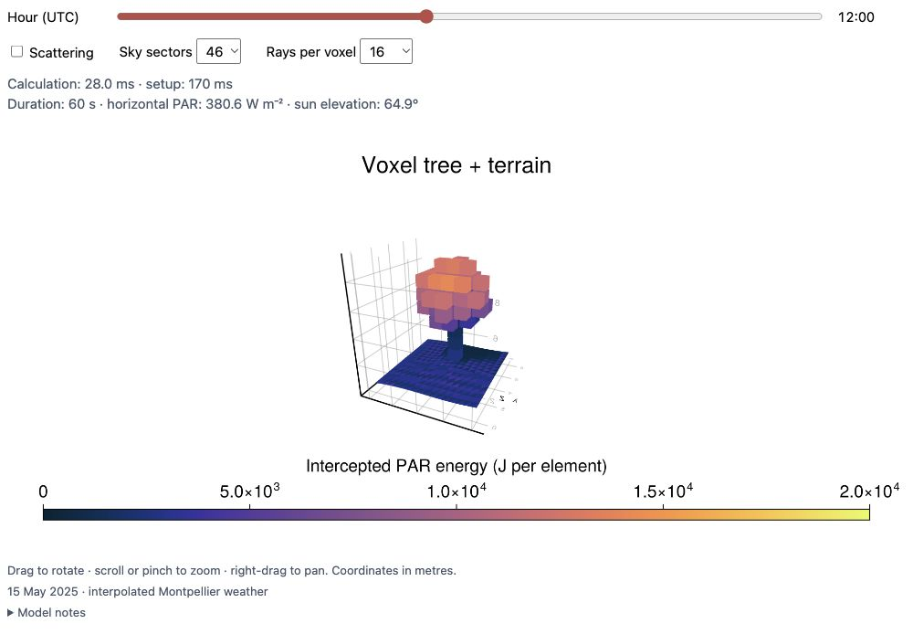
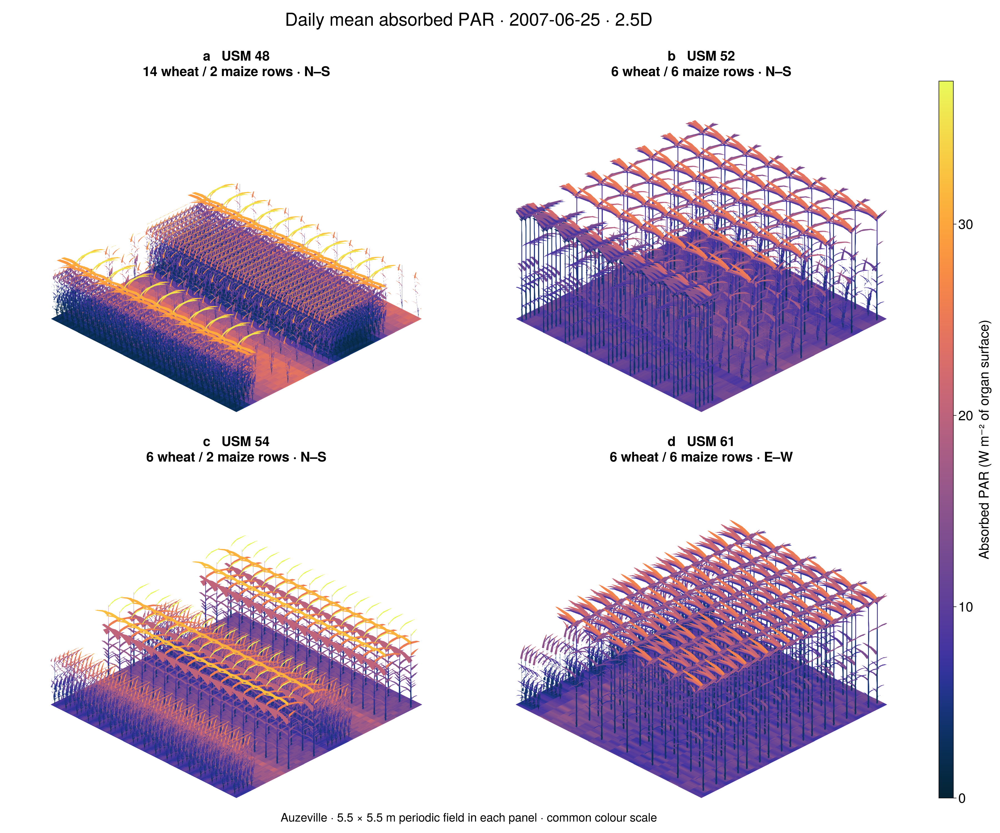
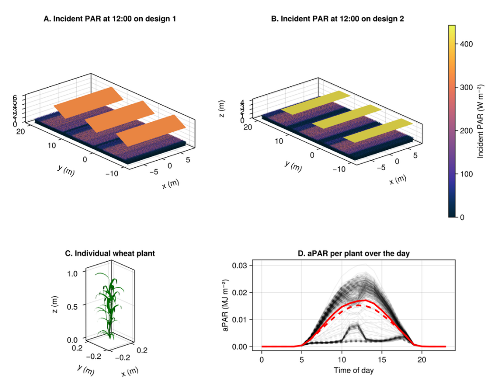
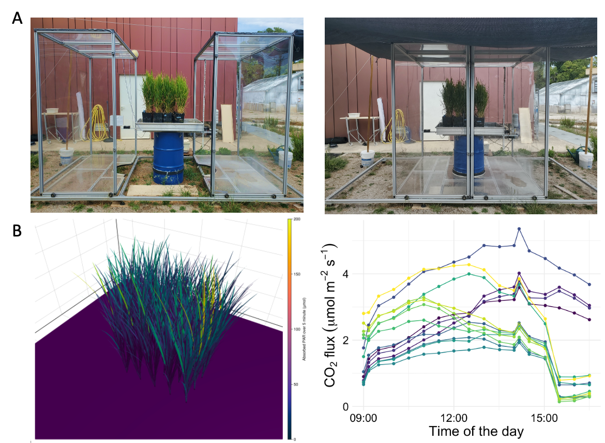
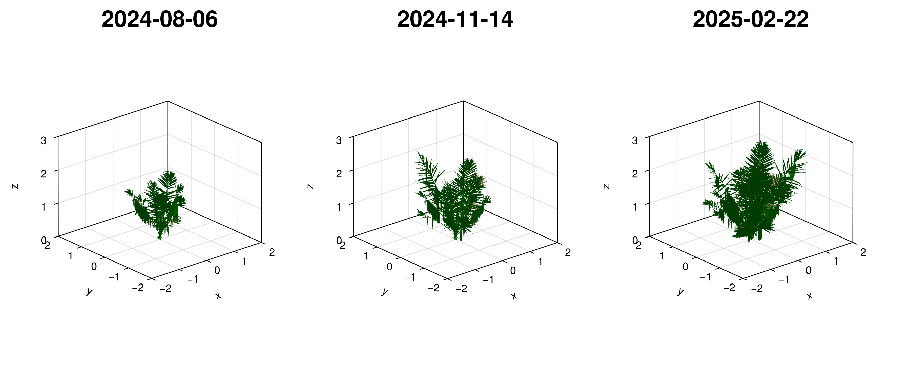
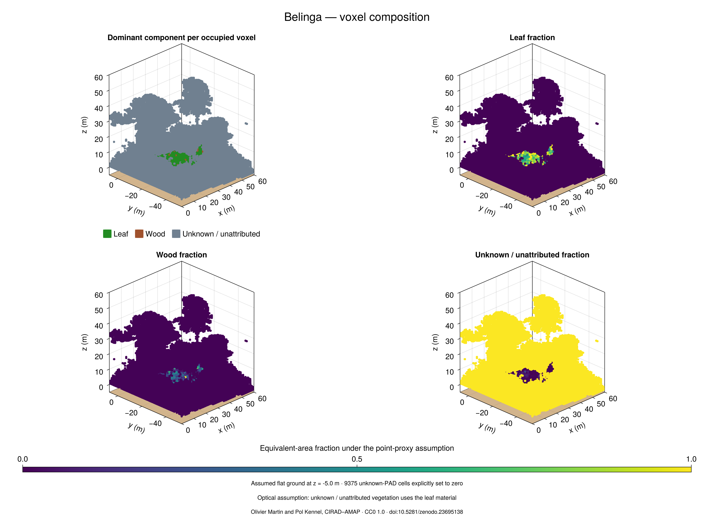

```@meta
CurrentModule = ArchimedLight
```

# Fast radiative transfer in 3D scenes

ArchimedLight.jl computes light interception and scattering in three-dimensional scenes, from individual organs or objects to crop canopies, using a fast radiation transfer model. Read an existing scene
or build one in Julia, simulate its light environment, and inspect incident and
absorbed radiation for each organ.

## Try it in your browser

Choose a wheat mesh or a voxel tree above terrain. Change the hour and options;
**light calculations run live in your browser.**

```@raw html
<div id="live-demo-switcher" role="group" aria-label="Choose a live scene" hidden>
  <button type="button" data-demo-target="live-wheat" aria-controls="live-wheat" aria-pressed="true">Wheat mesh</button>
  <button type="button" data-demo-target="live-voxel" aria-controls="live-voxel" aria-pressed="false">Voxel tree + terrain</button>
</div>
<figure id="live-wheat" class="live-light-demo" data-live-demo="wheat" data-title="Interactive wheat light interception" data-state="preview">
  <div class="live-wheat-stage" aria-busy="false">
    
  </div>
  <figcaption class="live-wheat-caption">
    <p>Wheat architecture generated with ArchiCrop (Braud et al. 2026).
    Colours show incident PAR irradiance on the plant and ground.</p>
    <span class="live-wheat-status" role="status" aria-live="polite"></span>
    <a class="live-wheat-open" href="assets/live-wheat/index.html" target="_blank" rel="noopener">Open standalone demo</a>.
  </figcaption>
  <noscript><p>Enable JavaScript to interact with the scene. The preview remains available above.</p></noscript>
</figure>
<figure id="live-voxel" class="live-light-demo" data-live-demo="voxel" data-title="Interactive voxel tree and terrain light interception" data-state="preview">
  <div class="live-wheat-stage" aria-busy="false">
    
  </div>
  <figcaption class="live-wheat-caption">
    <p>A tree from the bundled JSONL.gz example above a PLY terrain.
    Colours show incident PAR irradiance on the plant and ground.</p>
    <span class="live-wheat-status" role="status" aria-live="polite"></span>
    <a class="live-wheat-open" href="assets/live-voxel/index.html" target="_blank" rel="noopener">Open standalone demo</a>.
    <a href="voxel_tree_tutorial.html">Follow the voxel workflow</a>.
  </figcaption>
  <noscript><p>Enable JavaScript to interact with the scene. The preview remains available above.</p></noscript>
</figure>
```

```@raw html
<details>
  <summary>About the examples and more scenes</summary>
  <p>Both examples use interpolated Montpellier weather for 15 May 2025
  and ArchimedLight compiled to WebAssembly.</p>
  <p>The wheat benchmark has an unspecified cultivar. See the
  <a href="https://github.com/VEZY/ArchimedLight.jl/tree/main/docs/live_wheat">source, provenance and validation notes</a>
  for its scope and reproduction.</p>
  <p>The voxel example uses individual leaf/wood point proportions, illustrative
  optical properties and finite boundaries. See the
  <a href="voxel_overview.html">voxel modelling guide</a> for its assumptions.</p>
  <div class="archimed-animations">
    <video autoplay loop muted playsinline
           poster="assets/archimedlight_day_cycle_1.png"
           preload="metadata"
           style="max-width: 100%; height: auto;"
           aria-label="Wheat scene coloured by incident PAR irradiance.">
      <source src="assets/archimedlight_day_cycle_1.mp4" type="video/mp4">
      Your browser does not support embedded video.
    </video>
    <video autoplay loop muted playsinline
           poster="assets/archimedlight_day_cycle_2.png"
           preload="metadata"
           style="max-width: 100%; height: auto;"
           aria-label="Agrivoltaic wheat scene with shade from solar panels, coloured by incident PAR irradiance.">
      <source src="assets/archimedlight_day_cycle_2.mp4" type="video/mp4">
      Your browser does not support embedded video.
    </video>
  </div>
  <p>The day-cycle animations run the wheat and agrivoltaic wheat benchmark
  scenes every 30 minutes over a representative clear-sky day. About 2,500
  receiving ground tiles show the moving shade on the same incident-PAR scale.
  Reproduce them with
  <a href="https://github.com/VEZY/ArchimedLight.jl/blob/main/docs/make_video/make_video.jl">docs/make_video/make_video.jl</a>.</p>
</details>
```

## Applications

Explore how ArchimedLight is used to study light in measured plant architectures,
mixed crops, and environments shaped by solar panels.

```@raw html
<section id="applications-gallery" class="applications-gallery" aria-label="ArchimedLight applications">
  <div class="applications-toolbar">
    <a href="applications/index.html">Browse all applications <span aria-hidden="true">→</span></a>
    <div class="applications-controls" hidden>
      <button type="button" class="applications-previous" aria-label="Previous applications" aria-controls="applications-track"><span aria-hidden="true">←</span></button>
      <button type="button" class="applications-next" aria-label="Next applications" aria-controls="applications-track"><span aria-hidden="true">→</span></button>
    </div>
  </div>
  <ul id="applications-track" class="applications-track" aria-label="Application examples" tabindex="0">
    <li>
      <a class="application-card" href="applications/intercropping.html">
        
        <span class="application-card-body"><strong>Wheat–maize intercropping</strong><span>Oriane Braud</span></span>
      </a>
    </li>
    <li>
      <a class="application-card" href="applications/agrivoltaics.html">
        
        <span class="application-card-body"><strong>Agrivoltaics</strong><span>Corentin Coutellier</span></span>
      </a>
    </li>
    <li>
      <a class="application-card" href="applications/rice.html">
        
        <span class="application-card-body"><strong>Reconstructed rice</strong><span>Raphaël Pérez</span></span>
      </a>
    </li>
    <li>
      <a class="application-card" href="applications/oil-palm.html">
        
        <span class="application-card-body"><strong>Oil-palm reconstructions</strong><span>JPCE · CIRAD–PT SMART</span></span>
      </a>
    </li>
    <li>
      <a class="application-card" href="applications/belinga.html">
        
        <span class="application-card-body"><strong>Belinga natural forest</strong><span>Olivier Martin · Pol Kennel · CIRAD–AMAP</span></span>
      </a>
    </li>
  </ul>
</section>
```

## Quick Start

This tutorial simulated a coffee plant in a 3D scene.

```@example home_quick_start
using ArchimedLight

repo_root = normpath(joinpath(dirname(pathof(ArchimedLight)), ".."))
config = joinpath(repo_root, "example_2", "config.yml")
sim, meteo = read_simulation(config)
update_options!(sim, LightOptions(sim.options; pixel_size=0.01))

step = run_light(sim, first(meteo))

step.budget.incident_flux.total.par;
step.budget.absorbed_energy.total.par;
nothing # hide
```

The simulation results are returned as a `LightBudget`, grouped by quantity and waveband. You can then export the results and plot them easily. Look at the getting started page to see how.

## Learn More

- [Getting Started](getting_started.md): run your first simulation.
- [Voxel Modelling](voxel_overview.md): work with PAD grids, individual leaf/wood mixtures, and terrain instead of organ meshes.
- [File-Based Workflow](tutorial_files.md) and [Interactive Workflow](tutorial_interactive.md): load a scene or build one in memory.
- [Model Pipeline](theory_pipeline.md) and [Evaluation](evaluation.md): understand the methods and their validation.
- [PlantSimEngine Coupling](plantsimengine.md): connect light to other plant processes.
- [Configuration](reference_config.md), [Outputs](outputs.md) and [API Reference](api.md): find exact options and result definitions.
