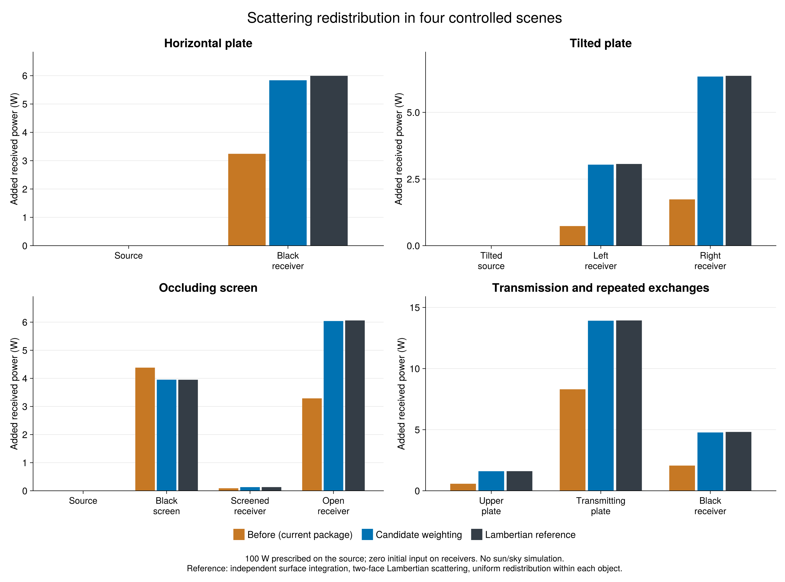

# Scattering evaluation and validation

## Current documentation viewer

`evaluate_current.jl` compares the loaded package with the independent surface
integral and object-uniform Lambertian reference in `reference.jl`, using shared
scene definitions from `run.jl`. Regular tests also use this oracle; keep these
sources and the recorded numerical outputs together.

Use a Kaimon-controlled session on the repository's `test` project:

```julia
using ArchimedLight
repo = pkgdir(ArchimedLight)
include(joinpath(repo, "validation", "scattering_comparison", "evaluate_current.jl"))
ScatteringCurrentEvaluation.run()
include(joinpath(repo, "scripts", "build_evaluation_asset.jl"))
EvaluationAssetBuilder.main()
EvaluationAssetBuilder.main(["--check"])
```

The evaluator writes `results-current.json` with the source revision, source
hashes, assumptions and numerical checks. The asset builder embeds only the
`current` and independent `reference` outputs in the existing JavaScript viewer.
It changes no viewer controls and performs no simulation or calibration itself.
The docs serve these saved outputs; their controls change the view.

## Historical three-way numerical comparison

Computed 2026-09-29 in a Kaimon-managed Julia 1.13.1 session, using ArchimedLight
`gpu` at `384a90d`. This section describes that saved snapshot; it is not a claim about the current checkout.

### What the three historical outputs mean

- **Before:** directional projections and unweighted scattering counts from that historical package snapshot.
  The reconstructed matrix is checked against the package's iterative scattering propagator to within 1e-8 W.
- **Corrected candidate:** exactly the same projections, with each direction's pair counts and full source
  hit totals multiplied by `abs(s_z) * sector.weight` before normalization. Escape remains in the denominator.
  This is a candidate calculation in the validation harness, not a claim that all production backends are patched.
- **Lambertian reference:** an independent double surface integral over rectangles, with explicit segment
  visibility. It uses neither the package raster nor its direction grid. Repeated exchanges are solved as a
  linear system. Uniform redistribution within each object and equal emission from both faces are retained.

All scenes prescribe **100 W initially intercepted by object 1 and zero on every other object**.
This isolates redistribution; it does not simulate an outdoor sky, lamp beam, or the initial shadow pattern.
The screen blocks subsequent source-to-receiver paths. Lengths are metres and the outputs are powers in watts.
Irradiance in W/m² is also exported in `object_outputs.csv` by dividing by geometric object area.

### Scenes

1. **Horizontal plate:** two equal 1 m squares, 1 m apart; source scattering coefficient 0.6,
   black receiver. The analytical received power is **5.99474687095 W**.
2. **Tilted plate:** a 45 degree source and two black receivers to distinguish angular redistribution.
3. **Occluding screen:** a black vertical screen partly hides one receiver while another stays unobstructed.
4. **Transmission and repeated exchanges:** upper and middle plates scatter 0.7 and 0.8 of intercepted power.
   The retained model splits these into `(reflection, transmission) = (0.35, 0.35)` and `(0.4, 0.4)`.
   A lower black plate collects light, including light transmitted diffusely through the middle plate.

The `transparency` parameter is held at zero. Its existing straight-through interception semantics are a
separate issue and are not used as a physical beam-transmission coefficient in these experiments.

### Main comparison

The 3D comparison and plots use **2304 equal-solid-angle directions**, **10 mm pixels**,
and **96 × 96 surface samples per rectangle** for the independent reference. Both before and candidate use
the same direction grid, raster, geometry, material coefficients, and initial power.

Maximum absolute error across objects, against the independent reference:

| Scene | Before (W) | Candidate (W) | Error reduction | Reference change, 48→96 subdivisions (W) |
|---|---:|---:|---:|---:|
| Horizontal plate | 2.7522 | 0.1571 | 94.3% | 0.00059 |
| Tilted plate | 4.6353 | 0.0273 | 99.4% | 0.00058 |
| Occluding screen | 2.7722 | 0.0205 | 99.3% | 0.00069 |
| Transmission and repeated exchanges | 5.6332 | 0.0430 | 99.2% | 0.00206 |

For the horizontal receiver specifically: **3.2427 W before →
5.8379 W candidate**, versus **5.9949 W** in the surface-integral reference.
The candidate's remaining error there is about **2.62% of receiver power**.



`comparison.pdf` is the vector export. `results.json` contains geometry, optics, all object powers,
escaped power and numerical diagnostics; `object_outputs.csv` contains the per-object numerical outputs.

### Resolution checks and limits

The correction improves every tested scene, but the numerical results are not fully converged.
The built-in turtle grids do not approach the continuum monotonically in these examples. The equal-solid-angle
grid helps isolate weighting from angular sampling, but finite pixel alignment and angular quadrature still matter.
The 46-direction run also uses larger pixels, so that column is not a pure angular refinement experiment.

| Scene | Turtle 46, 30 mm: error W | Turtle 406, 10 mm: error W | Equal-area 1024, 10 mm: error W | Equal-area 2304, 10 mm: error W | Pixel-only change, 20→10 mm at 1024 directions W |
|---|---:|---:|---:|---:|---:|
| Horizontal plate | 0.0353 | 0.3529 | 0.1145 | 0.1571 | 0.1620 |
| Tilted plate | 0.5175 | 0.2199 | 0.0389 | 0.0273 | 0.0433 |
| Occluding screen | 0.8670 | 0.3932 | 0.0424 | 0.0205 | 0.0181 |
| Transmission and repeated exchanges | 0.7917 | 0.4569 | 0.0481 | 0.0430 | 0.0444 |

Reference-refinement differences are empirical sensitivity estimates, not certified error bounds.
An additional Kaimon diagnostic confirmed a raster-alignment effect in the horizontal case: at nominal
10 mm pixels, the ground receiver occupies 10,000 pixels with the 1024-direction padded bounds but
9,801 pixels with the wider 2304-direction bounds. The exact same-direction overlap calculation predicts
5.938009282 W for the latter grid, versus 5.837879955 W from the candidate raster and 5.994746871 W
in the continuum. Thus angular sampling and raster coverage both contribute to the residual.
See `raster-phase-check.json` and `raster_phase.jl`. This diagnostic does not patch the raster algorithm.

For repeated exchanges, this checks the retained object-uniform approximation; a surface-resolved radiosity
or Monte Carlo solution would additionally test whether redistributing each object's energy uniformly is adequate.

The September run recorded **157 passing checks** on its stored outputs. They cover the analytical parallel-square view factor, area reciprocity, screen visibility,
an exact two-object geometric series, nonnegative absorption/escape, and package-propagator agreement.
Absorbed plus escaped power equals the prescribed input. The sum of cumulative received powers is **not**
an energy conservation test because the same energy can be received repeatedly.

### Historical diagnostic workflow

Exact reproduction of the September numbers requires the recorded `384a90d`
source revision and its resolved environment. Running the diagnostic on another
revision is a new numerical experiment; record its source and settings. Use a
disposable worktree or preserve the stored JSON, figures and CSV first. In the
Kaimon test session:

```julia
include(joinpath(repo, "validation", "scattering_comparison", "run.jl"))
ScatteringComparison.run(equal_area_rings=24, pixel=0.01, ref_subdivisions=96)
include(joinpath(repo, "validation", "scattering_comparison", "checks.jl"))
ScatteringComparisonChecks.run_checks()
include(joinpath(repo, "validation", "scattering_comparison", "plots.jl"))
ScatteringComparisonPlots.plot_comparison()
```

Stored variants use 46 or 406 turtle directions, or 1024 equal-area directions;
`resolution.jl` isolates the 20 mm pixel comparison. `object_outputs.csv` and the
handwritten report remain historical records and are not regenerated by the
current viewer asset builder. The [complete original report](https://github.com/VEZY/ArchimedLight.jl/blob/d5c188f27f855ecb23f1ab842e18fc679540fa8f/validation/scattering_comparison/README.md)
retains the old generation instructions and the original tables.

## Angular weighting investigation

The September 2026 issue #55 audit found an inherited angular weighting
inconsistency, rather than a regression introduced by the Julia port. Horizontal
raster hit counts already contain the projected source geometry. Lambertian
aggregation weights both per-direction links and **all** source hits, including
escaping paths, by `max(s_z, 0) * sector.weight`. The common solid-angle factor
cancels in the normalization; adding another source-normal cosine is incorrect.
Explicit sun sectors are excluded. Keep total scatterable energy fixed and
preserve the material's separate two-face convention.

The finite-source polygon oracle isolates this weighting at fixed directions;
pixel convergence does not establish angular convergence. The controlled two
collector/blocker tests check both faces, escape and visibility. Cumulative
received power can count repeated exchanges and is not a conserved quantity;
absorption plus terminal escapes is the relevant budget.

```julia
include(joinpath(repo, "scripts", "diagnose_scattering_angular.jl"))
ScatteringAngularDiagnostic.run_cases()
using TestItemRunner
TestItemRunner.run_tests(repo; filter=ti -> :scattering_angular in ti.tags)
```

The [full dated investigation](https://github.com/VEZY/ArchimedLight.jl/blob/d5c188f27f855ecb23f1ab842e18fc679540fa8f/scripts/diagnose_scattering_angular.md)
preserves numerical tables, historical test failures and backend coverage. Its
28 September document audit identified Lambertian intent and horizontal-raster
speed motivation in `ArchiMED.phys_documentation_JD_RV.docx` (pages 11–13, 17),
a different perpendicular-plane explanation in `Notes.docx` (pages 1–2), and the
unweighted two-face rule in `Formalisation des sources lumineuses.docx`.
These documents did not establish deliberate acceptance of a different angular
law. Their local paths and detailed evidence remain in that immutable record.

## Physical measurement candidates

Search and access checks: **28–29 September 2026**. The status below records what
was inspected during that search, rather than promising that a download service
will remain unchanged. No large measurement files are stored in this repository.

The September audit identified NREL's simple vertical testbed as a possible
geometry/shadowing check and the forest records as later transmission checks.
These remain candidates, not experiments reproduced or validated here. None
provides measured scattering orders or absorbed power on every object.
A simulation with scattering disabled is a model attribution experiment.

Match the optical representation explicitly. Triangle `Translucent` models
retain equal diffuse reflection/transmission; `opaque` supports oriented,
nonvertical ground rather than arbitrary vertical panels or closed objects.
Voxel materials have separate reflection/transmission coefficients with isotropic
vegetation scattering. None automatically reproduces measured non-Lambertian
BRDFs, real luminaire photometry, or every laboratory wall configuration.

### 1. NREL vertical testbed: recommended first experiment

[Dataset and manual](https://data.nlr.gov/submissions/254),
[DOI 10.7799/2479914](https://doi.org/10.7799/2479914).
Measurements span November 2023 to May 2024 in Golden, Colorado.

- **Scene:** three rows of opaque black plywood plates on support frames,
  representing a scaled vertical PV array. The manual gives dimensions and sensor
  positions: rows are 6.10 m long, plates are 0.61 m high and their lower edges are
  0.61 m above the ground. Geometry must be recreated from the manual; no mesh was
  verified. Array orientation and ground treatment change during the experiment.
- **Measurements:** six vertical irradiance sensors, five ground irradiance
  sensors and two PAR sensors. The scene CSV includes `IMT1`–`IMT6`, `Ap_1`–`Ap_5`,
  `PAR_con`, `PAR_pv`, `Array Azimuth` and `Reflector?` at one-minute intervals.
- **Forcing:** a separate 15-minute weather CSV supplies measured global horizontal
  irradiance (GHI), direct normal irradiance (DNI) and diffuse horizontal irradiance
  (DHI), plus `Testbed Albedo`. These totals constrain a sky model; they are not a
  measured angular sky map. The weather station is less than 60 m away.
- **What it tests:** solar geometry, obstruction, changing shadows, ground
  reflection and total radiation reaching receivers on both sides of a row.
- **Limits:** the plates do not transmit light. Some albedo values are prescribed
  from the ground treatment rather than measured continuously. Resolve the
  treatment periods and aggregate sensor and weather timestamps consistently.
  Sensor readings are incident radiation, not plate absorption or bounce counts.

**Access checked 28 September 2026:** both CSV payloads and the manual were
downloaded and inspected, including the geometry figure. The public landing page
was checked again on 29 September. It describes the data as open source; a
specific license text was not verified in this search.

Direct resources: [scene measurements](https://data.nlr.gov/system/files/254/1733510277-NREL_vertical_testbed_data.csv),
[weather](https://data.nlr.gov/system/files/254/1733510277-NREL_vertical_testbed_weatherdata.csv),
[manual](https://data.nlr.gov/system/files/254/1733527005-DATA%20MANUAL.pdf).

### 2. Hovi et al.: forest transmission with measured foliage optics

[Original laboratory and field data](https://doi.org/10.23729/9a8d90cd-73e2-438d-9230-94e10e61adc9),
[companion inputs and code](https://doi.org/10.23729/5b4dc41c-eb63-4e57-9e92-191a96c54341),
[data description](https://essd.copernicus.org/articles/16/5069/2024/).
Both archives use **CC BY 4.0**.

- **Scene and optics:** forest inventory, terrestrial laser scans, hemispherical
  photographs, measured forest-floor reflectance and measured reflectance and
  transmittance of both sides of foliage. Companion files include
  `forest_structure.csv`, `tree_crown_dimensions_from_TLS-FINAL.csv`, `leaf_R.csv`
  and `leaf_T.csv`. Crown and voxel models reconstruct the scene; positions and
  orientations of every leaf are not known.
- **Measurements:** spectral canopy transmission at 49 locations per plot, using
  below-canopy and open-site reference spectrometers over 350–2500 nm. The
  measurements were made under clear skies; the reference was less than 2 km away.
  The companion study uses 21 forest plots.
- **What it tests:** spatial and spectral transmission through real foliage,
  including the combined effects of gaps, leaf transmission and reflection.
- **Limits:** companion `total_irradiance.csv` and
  `diffuse_to_total_irradiance.csv` were calculated with libRadtran and atmospheric
  data. They are not independent measured sky forcing. Separating geometry error
  from scattering error is harder than in the plate experiment. The observed
  canopy transmission remains an empirical ratio to the reference measurement.

**Access checked 29 September 2026:** public metadata and file inventories were
retrieved. They list `spectra_canopy_transmittance.csv` (30.1 MB) in the original
archive and `canopytransmittance_measurements.csv` (40.8 MB) in the companion
archive. **Measurement payload download was not completed.** The tested Metax v3
download endpoint returned `Download is not enabled`; this does not establish
that the Etsin website's download route is unavailable. Do not describe these
CSVs as locally verified measurements yet. The companion archive also contains
simulation outputs, which must not be used as experimental truth.

### 3. Linden tree: measured moving shadows with scanned geometry

[Zenodo record](https://zenodo.org/records/18039731),
[complete archive](https://zenodo.org/api/records/18039731/files/Data_TiliaCordata.zip/content),
[measurement paper](https://doi.org/10.1038/s41597-026-07536-1).
License: **CC BY 4.0**. Measurements cover 11–14 June 2025 in Germany.

- **Scene and measurements:** a mature linden tree, raw and cleaned LAS point
  clouds, and 48 light sensors on a 7 × 7 grid with the tree at the centre and
  2 m spacing. Raw lux readings are sampled every 20 seconds. An unshaded SN500
  reference supplies incoming and outgoing shortwave and longwave radiation at
  five-second intervals. The archive also contains time-indexed sky photographs.
- **What it tests:** reconstructed canopy geometry, moving shadows and spatial
  variation in light beneath a tree.
- **Limits:** no measured leaf reflectance/transmittance or measured DNI/DHI were
  verified. RGB sky photographs are not calibrated angular sky radiance. The
  ground `Watt` files are regression conversions of lux, not independent broadband
  irradiance measurements. A comparison in lux needs a matching photometric
  response; a comparison in W/m² must account for conversion uncertainty and the
  spectral change caused by foliage. This is not a clean scattering-only test.

**Access checked 29 September 2026:** the 7.58 GB ZIP's directory was inspected
without downloading the full archive. Actual files downloaded and inspected:
`BH1750_Grid_48Stations_Lux_UTC+1.csv`, `Grid_Station_Positions.txt` and
`SN500_Radiation_Components_UTC+1.csv`. LAS and sky-image files were listed but not
downloaded. The position file explicitly maps station numbers to the grid.

### 4. Raspberry agrivoltaics: semitranslucent plates, with unresolved inputs

[Dataset](https://doi.org/10.48804/FLUHT1),
[experimental study](https://www.frontiersin.org/journals/horticulture/articles/10.3389/fhort.2026.1716398/full).
License: **CC BY-NC-ND 4.0**. Measurements were collected in the Netherlands in 2021.

- **Scene:** semitranslucent and opaque PV rows above raspberry crops. The paper
  specifies panel dimensions, heights, azimuths and row gaps. The semitranslucent
  panels have nominal 50% translucency. Controls use plastic covers at Lierop and
  open air at Someren.
- **Measurements:** the Lierop workbook retains 20 individual PAR sensor columns
  labelled in PPFD, plus timestamps and temperature/humidity measurements.
- **What it could test:** shadowing and partial transmission through a simpler
  arrangement of objects than a forest, once receiver positions and optics are
  resolved.
- **Limits:** the verified README does not map PAR sensor numbers to positions;
  no CAD file or full measured reflection/transmission properties was verified.
  The paper uses GHI from a station 15–28 km away and estimates DNI/DHI with the
  Erbs model. Those weather data are not included in the inspected workbook.
  Initial spreadsheet timestamps are one minute apart, whereas the paper states
  ten-minute PAR measurements: resolve this before selecting a comparison period.
  The paper's spatial PAR maps are simulations, not measured maps.

**Access checked 29 September 2026:** the [README](https://rdr.kuleuven.be/api/access/datafile/336642)
and [Lierop workbook](https://rdr.kuleuven.be/api/access/datafile/332126) (9.27 MB,
41,576 data rows) were downloaded and inspected. The
[Someren workbook](https://rdr.kuleuven.be/api/access/datafile/332125) (9.43 MB) was
listed but not downloaded. These are useful empirical data, but the unresolved
sensor mapping and optical inputs prevent treating them as a ready validation
case.

### Complementary material and laboratory records

These are the additional candidates recorded by the September access audit;
no new download or experimental validation is claimed by this guide.

| Record | What was inspected | Use and unresolved requirements |
| --- | --- | --- |
| [NIST PTFE, Germer 2017](https://opticapublishing.figshare.com/articles/dataset/Supplementary_Data_zip/5417410) | Measured CSVs and README; 7,296 BRDF measurements at 351/532/633/1064 nm and 1,760 additional 532 nm measurements; CC BY 4.0. | Preserve signed-angle conventions and units; fitted coefficient files are not measurements. Compare BRDF or aperture-integrated reflected power; PTFE is only approximately Lambertian. |
| [LOTUS](https://doi.org/10.20383/103.0606) | README and paired angular files; 290 leaf samples, normal-incidence R/T plus independent hemispherical measurements; CC BY 4.0. | One-plane 5° samples are not arbitrary-incidence BRDFs. Raw files contain masks/zero padding; verify instrument conventions and the [PROSPECULAR conversion](https://doi.org/10.1016/j.rse.2023.113754), including grazing-angle behavior. |
| [Leroy target, version 3](https://zenodo.org/records/11941003) | Two NetCDF headers downloaded; `final_design.ply` listed, not downloaded. | Target and material responses are measured separately. Reproduce illumination, detector geometry, uncertainties and non-Lambertian behavior before using the [paper's comparison](https://doi.org/10.1109/TGRS.2025.3547305). |
| [CIE 171:2006](https://www.cie.co.at/publications/test-cases-assess-accuracy-lighting-computer-programs) | Public [Relux validation report](https://relux.com/assets/static/global/documents/ReluxDesktop_validation_report_Final.pdf); full standard requires paid access. | Experimental room cases 4.1–4.6 contain measured lux; section 5 is analytical. Complete geometry/lamp definitions and compatible opaque-wall optics are needed. |
| [Schregle and Wienold 2004](https://doi.org/10.1111/j.1467-8659.2004.00807.x) | Paper and [thesis chapter 7](https://publikationen.sulb.uni-saarland.de/bitstream/20.500.11880/25918/1/Dissertation_7530_Schr_Rola_2004.pdf). | Test-box geometry, lamp characterization, measured curves and uncertainty described; no raw numerical archive verified. Cloth departs from exact Lambertian behavior. |
| [Original Cornell Box](https://bowers.cornell.edu/computer-graphics/data) | Data page with measured geometry, spectra and image links; intact image archive not verified. | Observable is outgoing camera radiance, not local incident irradiance or per-object absorption. Match spectral response and camera geometry. |

[NASA CHAR plate examples](https://ntrs.nasa.gov/citations/20160006076) provide
analytical verification, including equal parallel squares with one-face view
factor about 0.19982 (0.09991 of the equal two-face scattered pool).
[RAMI-V scenes](https://eradiate.eu/data/store/unstable/scenarios/rami5/) support
model intercomparison, not independent measured radiation truth; changing their
specified optics makes a custom case.

For any empirical comparison, retain sensor position, orientation, aperture,
spectral response, forcing conventions and uncertainty. Lux-to-power conversion
requires spectral information. Keep measured optics independent of the output
being evaluated; parameter fitting is calibration, not independent validation.
The [original detailed candidate notes](https://github.com/VEZY/ArchimedLight.jl/blob/d5c188f27f855ecb23f1ab842e18fc679540fa8f/scripts/diagnose_scattering_angular.md)
retain the additional URLs, conversion details and historical access findings.
